<!--
  ┌──(dhell@uc)-[~/profile]
  └─$ every image in ./assets is an animated SVG generated for this README.
      the snake comes from .github/workflows/snake.yml (it fills the "output" branch).
-->

  

  
  
  

  


  <a href="https://github.com/Dhellss/LifeOS"></a>
  <a href="https://github.com/Dhellss/linux-system-observatory"></a>
  <a href="https://github.com/Dhellss/Notely"></a>
  <a href="https://github.com/Dhellss/student-management-system"></a>
  <a href="https://github.com/Dhellss/dark-splash"></a>
  <a href="https://github.com/Dhellss/MP4_to_MP3_Converter"></a>


  <a href="https://dhellss.github.io/dash-break/"></a>
  <a href="https://dhellss.github.io/Below_100m/"></a>
  <a href="https://dhellss.github.io/tetris/"></a>
  <a href="https://dhellss.github.io/the-last-room/"></a>
  <a href="https://dhellss.github.io/zombie-night/"></a>

  <code>$ ls ./source</code> &nbsp;→&nbsp;
  <a href="https://github.com/Dhellss/dash-break">dash-break</a> ·
  <a href="https://github.com/Dhellss/Below_100m">Below_100m</a> ·
  <a href="https://github.com/Dhellss/tetris">tetris</a> ·
  <a href="https://github.com/Dhellss/the-last-room">the-last-room</a> ·
  <a href="https://github.com/Dhellss/zombie-night">zombie-night</a>

  <b><code>// smaller arcade payloads</code></b> 
  <a href="https://dhellss.github.io/pulse/"><code>pulse</code></a> ·
  <a href="https://dhellss.github.io/patrol/"><code>patrol</code></a> ·
  <a href="https://dhellss.github.io/keycrack/"><code>keycrack</code></a> ·
  <a href="https://dhellss.github.io/inject/"><code>inject</code></a> ·
  <a href="https://dhellss.github.io/kernel-route/"><code>kernel::route</code></a> ·
  <a href="https://dhellss.github.io/handshake/"><code>handshake</code></a> ·
  <a href="https://dhellss.github.io/ProjectBato/"><code>Project Bato</code></a>


  <a href="https://dhellss.github.io/Network/"></a>

  <code>// one set of content, seven different worlds</code>
    
  <a href="https://dhellss.github.io/Network/"><b>Network</b></a> — every project is a node you can drag and trace back to GitHub
    
  <a href="https://dhellss.github.io/Dragon/"><code>Dragon</code></a> ·
  <a href="https://dhellss.github.io/Terminal/"><code>Terminal</code></a> ·
  <a href="https://dhellss.github.io/OS/"><code>OS</code></a> ·
  <a href="https://dhellss.github.io/Grid/"><code>Grid</code></a> ·
  <a href="https://dhellss.github.io/Prompt/"><code>Prompt</code></a> ·
  <a href="https://dhellss.github.io/Readme/"><code>Readme</code></a>


  <a href="https://dhellss.github.io/SQL-Learning/">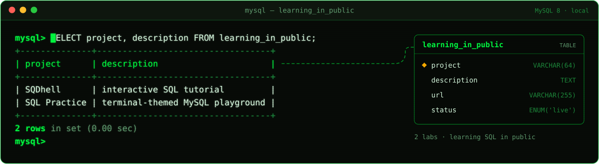 SELECT project, description FROM learning_in_public;" /></a>

  <a href="https://dhellss.github.io/SQL-Learning/"><b>SQDhell</b></a> — interactive SQL tutorial &nbsp;·&nbsp;
  <a href="https://dhellss.github.io/SQL-Practice/"><b>SQL Practice</b></a> — terminal-themed MySQL playground
    
  <a href="https://mlkhr.netlify.app"><b>→ ssh into everything at once: my portfolio</b></a>


  <code>[ LOADED ]</code>
    
  
    
  <code>[ ENVIRONMENT ]</code>
    
  
    
  <code>[ DOWNLOADING... ▓▓▓▓▓▓░░░░ ]</code>
    
  


  

<picture>
  <source media="(prefers-color-scheme: dark)" srcset="https://raw.githubusercontent.com/Dhellss/Dhellss/output/github-snake-dark.svg" />
  <source media="(prefers-color-scheme: light)" srcset="https://raw.githubusercontent.com/Dhellss/Dhellss/output/github-snake.svg" />
  
</picture>

  

